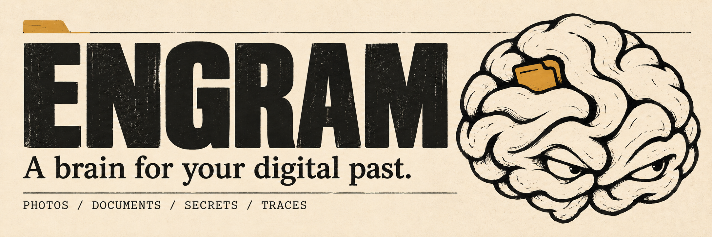
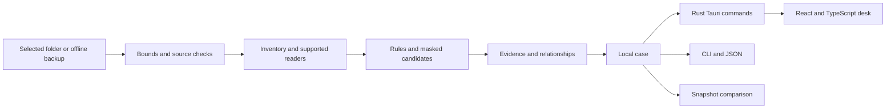

<p align="center"></p>

<p align="center">
  <a href="https://github.com/Forem0/ENGRAM/actions/workflows/ci.yml"></a>
  
  
  
  
  <a href="LICENSE"></a>
</p>

<p align="center"><strong>Inspect the traces preserved in your files and backups.</strong><br/>A native workspace for media, documents, secret candidates and the connections between them.</p>

<p align="center"><a href="#start-with-the-demo">Build the desktop</a> · <a href="#what-works">Capabilities</a> · <a href="docs/METHODOLOGY.md">Methodology</a> · <a href="docs/COMMANDS.md">CLI</a> · <a href="docs/PRIVACY.md">Privacy</a> · <a href="README.ru.md">Русский</a></p>

## A brain for your digital past

Deleting an item from an application does not tell you whether another copy exists in an archive, an export or a thumbnail directory. ENGRAM examines the **offline sources you choose**, connects matching artifacts, and keeps the evidence behind every finding visible.

The desktop uses **Tauri 2 with React and TypeScript**, backed by the same Rust analysis engine as the CLI. React handles the memory desk; Rust owns source selection, analysis, case validation and persistence. A case contains source coverage, paths, rules, hashes, available timestamps, relationships and inspection limits. Secret candidates are masked before they reach the case.

**This is a Developer Preview.** It is an inspection tool, not a guarantee that deleted data can be recovered. A thumbnail without a catalogue match is a candidate to review. A secret-shaped string is not a verified working credential. No finding proves that an application read or transmitted your data.

## The workspace

The 0.2 source introduces a responsive editorial memory desk, with an SVG brain map, keyboard-friendly controls, shared filters and a persistent evidence inspector. Source operations use native dialogs and the Rust command bridge.

Tauri captures are generated by the native-window CI smoke test. Earlier screenshots and the [0.1 release](https://github.com/Forem0/ENGRAM/releases/tag/v0.1.0-preview.1) belong to the historical egui interface; they do not represent the React/Tauri build. New release downloads and captures are published only after verification.

- **Memory map** — category clusters inside a brain-shaped map; open a cluster to inspect its findings.
- **Findings** — search, filter and inspect the exact source and rule behind an artifact.
- **Timeline** — available timestamps shown with their source meaning, not invented deletion times.
- **Connections** — follow relationships established by the engine, including exact-content duplicates.
- **Compare** — compare two saved cases and see added, removed, changed and unchanged findings.
- **Modules** — see what is ready, experimental, planned or unavailable for the current source.

The demonstration is generated from synthetic files and run through the real engine. It does not inspect your personal directories.

## What works

| Module | State | What the current source implements |
| --- | --- | --- |
| Folder inventory | **Ready** | bounded reads of explicitly selected files, media/document metadata and coverage warnings |
| Secret candidates | **Ready** | supported text patterns; masked findings and within-case matching without credential validation |
| Duplicate relationships | **Ready** | exact-content relationships for files the scan can hash |
| Case memory | **Ready** | local JSON cases, reopening and snapshot comparison |
| iPhone backup index | **Experimental** | unencrypted `Manifest.db` mapping and best-effort Photos catalogue/thumbnail association |
| Browser history | **Experimental** | supported Chromium and Safari SQLite schemas, when present in the selected source |
| Message metadata | **Experimental** | supported SMS SQLite rows, when present in the selected source |
| Deleted-record / WAL carving | **Planned** | journals can accompany database copies; deleted-record reconstruction is not implemented |
| Keychain recovery | **Planned** | no protected-vault unlocking, passcode recovery or recovery of arbitrary deleted passwords |
| Location / OCR | **Planned** | no automatic location reconstruction or image-text extraction in this preview |
| Application access attribution | **Planned** | no inference that an app read a file from the existence of a permission or artifact |

An experimental parser can work for a supported source while remaining incomplete across OS and application versions. ENGRAM reports unsupported data and read limits instead of treating missing coverage as a clean result.

## Start with the demo

Build the current Tauri desktop from source with Node.js 24, a compatible Rust toolchain and the platform prerequisites in [building](docs/BUILDING.md). The published 0.1 packages use the earlier egui interface.

```bash
git clone https://github.com/Forem0/ENGRAM.git
cd ENGRAM
cd apps/desktop
npm ci
npm run tauri -- dev -- -- --demo
```

The GUI starts in a synthetic case. Choose a source folder explicitly to inspect real files. An iPhone backup is selected as a local backup folder; plugging in a phone alone does not expose its private filesystem.

`npm run dev` starts a browser-only preview with a checked-in synthetic case generated by the Rust CLI. Real source selection, opening and saving cases require the native Tauri app. A browser preview is not a native execution test.

For the CLI, from the repository root:

```bash
cargo run -p engram-cli -- doctor
cargo run -p engram-cli -- demo --out demo.engram.json
cargo run -p engram-cli -- inspect demo.engram.json
```

Generate a reproducible source, then scan it with the real engine:

```bash
cargo run -p engram-cli -- fixture ./sample-source
cargo run -p engram-cli -- scan ./sample-source --out ./sample.engram.json
cargo run -p engram-cli -- inspect ./sample.engram.json --json
```

The CLI refuses to write its case inside the selected source or overwrite an existing output file. Store case exports separately from the material being inspected.

## Make a second observation

```bash
cargo run -p engram-cli -- scan ./sample-source --out ./before.engram.json
# Change a synthetic test file, then inspect the source again.
cargo run -p engram-cli -- scan ./sample-source --out ./after.engram.json
cargo run -p engram-cli -- compare ./before.engram.json ./after.engram.json
```

Comparison describes the two supplied snapshots. A finding absent from the second snapshot does not prove that every copy was securely erased. Different sources, scan limits, backup dates and parser support affect the comparison.

## Evidence, not a mystery score

Every finding has a confidence label:

| Label | Meaning |
| --- | --- |
| **Observed** | The supported reader observed this artifact in the supplied source. |
| **Linked** | The engine established a documented relationship between artifacts. |
| **Candidate** | A heuristic or incomplete association needs review. |

There is no invented percentage for how much of your phone is "exposed". The useful questions are concrete: **which file, which rule, which bytes, which source, and what was outside the inspection?**



## Privacy by construction

The analyzer runs locally and does not contact a model, credential endpoint, telemetry collector or recovery service. The renderer calls a small Rust command surface; it does not receive a general filesystem or shell API. Real sources are selected in native dialogs. ENGRAM does not unlock Keychain, attach to a live browser or write into source databases.

Case files still contain sensitive metadata: filenames, paths, URLs and relationships may reveal personal information even when secrets are masked. Keep cases private and use generated fixtures when sharing a bug report. Read [privacy and threat boundaries](docs/PRIVACY.md).

## Build, test and inspect

```bash
cargo fmt --all -- --check
cargo test -p engram-core -p engram-cli --locked
cd apps/desktop
npm ci
npm run typecheck
npm test
npm run build
cd ../..
cargo test -p engram-desktop --features engram-desktop/custom-protocol --locked
cargo clippy --workspace --all-targets --features engram-desktop/custom-protocol --locked -- -D warnings
```

Tests use synthetic sources. Core and CLI tests cover parsing, masking, source preservation, bounds, relationships, case persistence and comparison. Frontend tests and type checking cover the renderer; backend tests cover native command/session behavior. [CI](.github/workflows/ci.yml) checks all three desktop platforms and launches actual Tauri/WebKit windows under an isolated Linux display to verify the frontend-to-Rust demo path.

## Project map

```text
crates/engram-core/       source readers, rules, relationships and case model
crates/engram-cli/        terminal commands and machine-readable output
apps/desktop/src/         React/TypeScript memory desk and typed IPC bridge
apps/desktop/src-tauri/   native Tauri shell, dialogs and Rust session commands
assets/                  brand and captured application screenshots
docs/                    methodology, privacy, commands and roadmap
.github/workflows/       checks and opt-in build artifacts
```

The repository contains no personal backup, working credential or live recovery claim. See [methodology](docs/METHODOLOGY.md), [architecture](docs/ARCHITECTURE.md), [roadmap](docs/ROADMAP.md) and [contribution guidance](CONTRIBUTING.md).

## License

[MIT](LICENSE). Built for people who want to understand the traces in their own data.
