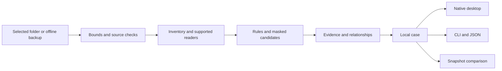

<p align="center"></p>

<p align="center">
  <a href="https://github.com/Forem0/ENGRAM/actions/workflows/ci.yml"></a>
  <a href="https://github.com/Forem0/ENGRAM/releases/tag/v0.1.0-preview.1"></a>
  
  
  <a href="LICENSE"></a>
</p>

<p align="center"><strong>Inspect the traces preserved in your files and backups.</strong><br/>A native workspace for media, documents, secret candidates and the connections between them.</p>

<p align="center"><a href="https://github.com/Forem0/ENGRAM/releases/tag/v0.1.0-preview.1">Download</a> · <a href="#start-with-the-demo">Try the demo</a> · <a href="#what-works">Capabilities</a> · <a href="docs/METHODOLOGY.md">Methodology</a> · <a href="docs/COMMANDS.md">CLI</a> · <a href="docs/PRIVACY.md">Privacy</a> · <a href="README.ru.md">Русский</a></p>

## A brain for your digital past

Deleting an item from an application does not tell you whether another copy exists in an archive, an export or a thumbnail directory. ENGRAM examines the **offline sources you choose**, connects matching artifacts, and keeps the evidence behind every finding visible.

The native desktop and the CLI use the same Rust analysis engine. A case contains source coverage, paths, rules, hashes, timestamps where available, relationships and the limitations of the inspection. Secret candidates are masked before they reach the case.

**This is a Developer Preview.** It is an inspection tool, not a guarantee that deleted data can be recovered. A thumbnail without a catalogue match is a candidate to review. A secret-shaped string is not a verified working credential. No finding proves that an application read or transmitted your data.

## The workspace


[Findings](assets/screenshots/findings.png) · [Timeline](assets/screenshots/timeline.png) · [Connections](assets/screenshots/connections.png) · [Capture provenance](assets/screenshots/README.md)

- **Memory map** — category clusters inside a brain-shaped map; open a cluster to inspect its findings.
- **Findings** — search, filter and inspect the exact source and rule behind an artifact.
- **Timeline** — available timestamps shown with their source meaning, not invented deletion times.
- **Connections** — follow relationships established by the engine, including exact-content duplicates.
- **Compare** — compare two saved cases and see added, removed, changed and unchanged findings.
- **Modules** — see what is ready, experimental, planned or unavailable for the current source.

The demonstration is generated from synthetic files and run through the real engine. It does not inspect your personal directories.

## What works

| Module | State | What the current source implements |
| --- | --- | --- |
| Folder inventory | **Ready** | bounded reads of explicitly selected files, media/document metadata and coverage warnings |
| Secret candidates | **Ready** | supported text patterns; masked findings and within-case matching without credential validation |
| Duplicate relationships | **Ready** | exact-content relationships for files the scan can hash |
| Case memory | **Ready** | local JSON cases, reopening and snapshot comparison |
| iPhone backup index | **Experimental** | unencrypted `Manifest.db` mapping and best-effort Photos catalogue/thumbnail association |
| Browser history | **Experimental** | supported Chromium and Safari SQLite schemas, when present in the selected source |
| Message metadata | **Experimental** | supported SMS SQLite rows, when present in the selected source |
| Deleted-record / WAL carving | **Planned** | journals can accompany database copies; deleted-record reconstruction is not implemented |
| Keychain recovery | **Planned** | no protected-vault unlocking, passcode recovery or recovery of arbitrary deleted passwords |
| Location / OCR | **Planned** | no automatic location reconstruction or image-text extraction in this preview |
| Application access attribution | **Planned** | no inference that an app read a file from the existence of a permission or artifact |

An experimental parser can work for a supported source while remaining incomplete across OS and application versions. ENGRAM reports unsupported data and read limits instead of treating missing coverage as a clean result.

## Start with the demo

[Download the native Developer Preview](https://github.com/Forem0/ENGRAM/releases/tag/v0.1.0-preview.1) for Windows x64, macOS Apple Silicon or Linux x64. The Windows ZIP includes a `START-HERE.txt` guide. The packages are unsigned preview builds; checksums and build provenance accompany them.

To build from source:

Use a Rust toolchain compatible with the workspace. Native builds also need the platform's usual C/C++ linker and desktop libraries; see [building](docs/BUILDING.md).

```bash
git clone https://github.com/Forem0/ENGRAM.git
cd ENGRAM
cargo run -p engram-desktop -- --demo
```

The GUI starts in a synthetic case. Choose a source folder explicitly to inspect real files. An iPhone backup is selected as a local backup folder; plugging in a phone alone does not expose its private filesystem.

For the CLI:

```bash
cargo run -p engram-cli -- doctor
cargo run -p engram-cli -- demo --out demo.engram.json
cargo run -p engram-cli -- inspect demo.engram.json
```

Generate a reproducible source, then scan it with the real engine:

```bash
cargo run -p engram-cli -- fixture ./sample-source
cargo run -p engram-cli -- scan ./sample-source --out ./sample.engram.json
cargo run -p engram-cli -- inspect ./sample.engram.json --json
```

The CLI refuses to write its case inside the selected source or overwrite an existing output file. Store case exports separately from the material being inspected.

## Make a second observation

```bash
cargo run -p engram-cli -- scan ./sample-source --out ./before.engram.json
# Change a synthetic test file, then inspect the source again.
cargo run -p engram-cli -- scan ./sample-source --out ./after.engram.json
cargo run -p engram-cli -- compare ./before.engram.json ./after.engram.json
```

Comparison describes the two supplied snapshots. A finding absent from the second snapshot does not prove that every copy was securely erased. Different sources, scan limits, backup dates and parser support affect the comparison.

## Evidence, not a mystery score

Every finding has a confidence label:

| Label | Meaning |
| --- | --- |
| **Observed** | The supported reader observed this artifact in the supplied source. |
| **Linked** | The engine established a documented relationship between artifacts. |
| **Candidate** | A heuristic or incomplete association needs review. |

There is no invented percentage for how much of your phone is "exposed". The useful questions are concrete: **which file, which rule, which bytes, which source, and what was outside the inspection?**



## Privacy by construction

The analyzer runs locally and does not contact a model, credential endpoint, telemetry collector or recovery service. It does not discover and scan personal directories automatically. It does not unlock Keychain, attach to a live browser or write into source databases.

Case files still contain sensitive metadata: filenames, paths, URLs and relationships may reveal personal information even when secrets are masked. Keep cases private and use generated fixtures when sharing a bug report. Read [privacy and threat boundaries](docs/PRIVACY.md).

## Build, test and inspect

```bash
cargo fmt --all -- --check
cargo test -p engram-core -p engram-cli
cargo clippy --workspace --all-targets -- -D warnings
cargo build -p engram-desktop --release
```

Tests use synthetic sources. They cover supported parsing, masked secret handling, source-preserving reads, bounds, relationships, case persistence, comparison and CLI workflows. Native builds are checked on Windows, macOS and Linux in [CI](.github/workflows/ci.yml).

## Project map

```text
crates/engram-core/       source readers, rules, relationships and case model
crates/engram-desktop/    native brain map and inspection workspace
crates/engram-cli/        terminal commands and machine-readable output
assets/                  brand and captured application screenshots
docs/                    methodology, privacy, commands and roadmap
.github/workflows/       checks and opt-in build artifacts
```

The repository contains no personal backup, working credential or live recovery claim. See [methodology](docs/METHODOLOGY.md), [architecture](docs/ARCHITECTURE.md), [roadmap](docs/ROADMAP.md) and [contribution guidance](CONTRIBUTING.md).

## License

[MIT](LICENSE). Built for people who want to understand the traces in their own data.
