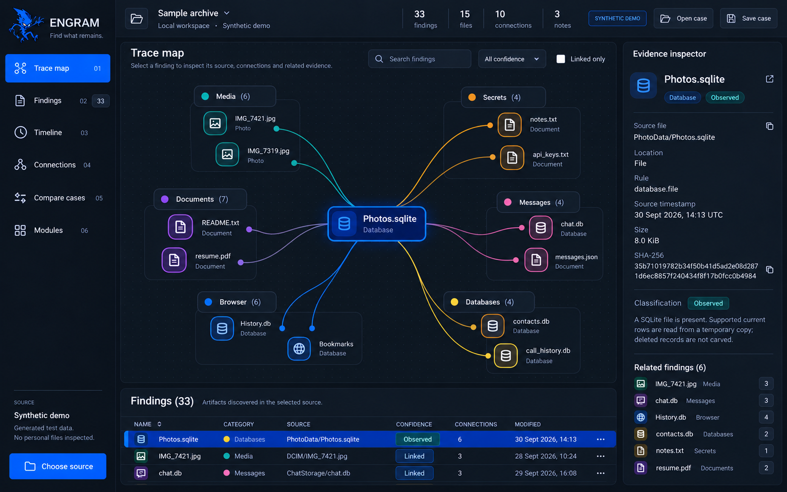
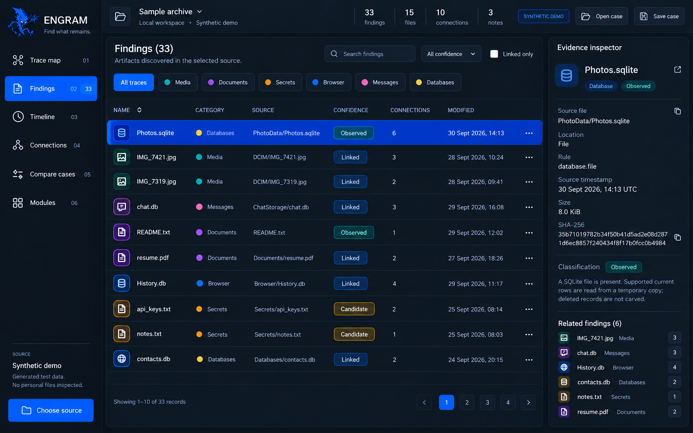
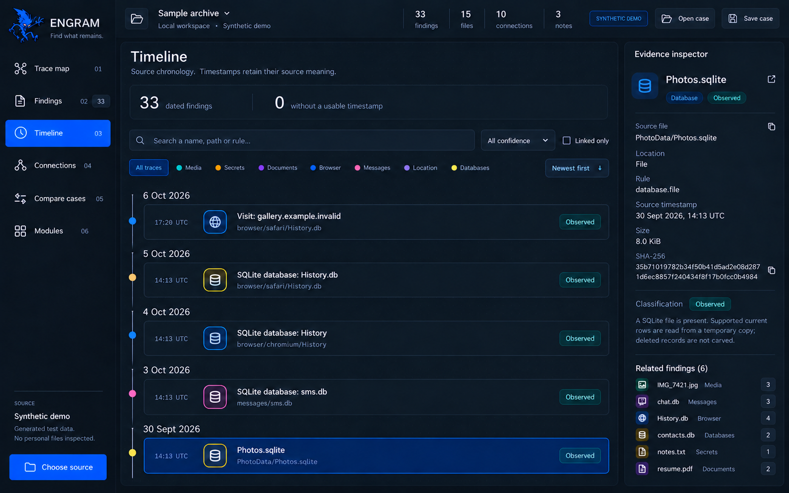
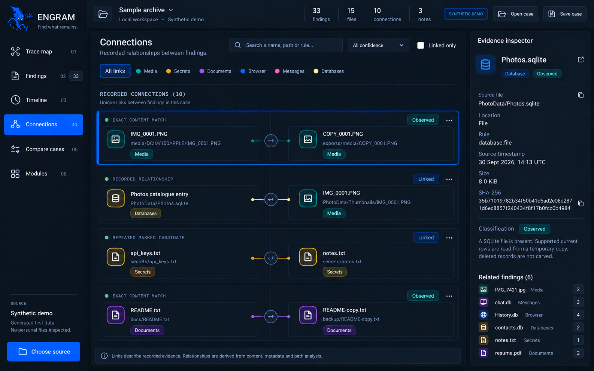
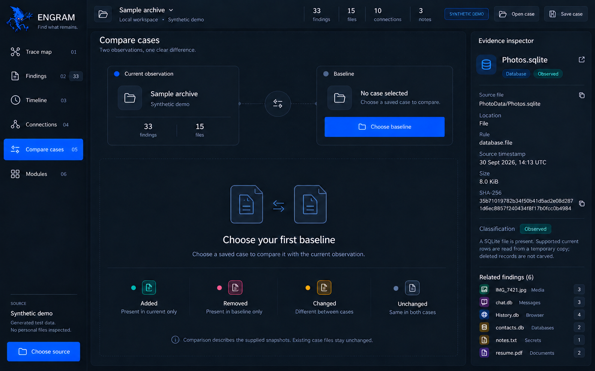
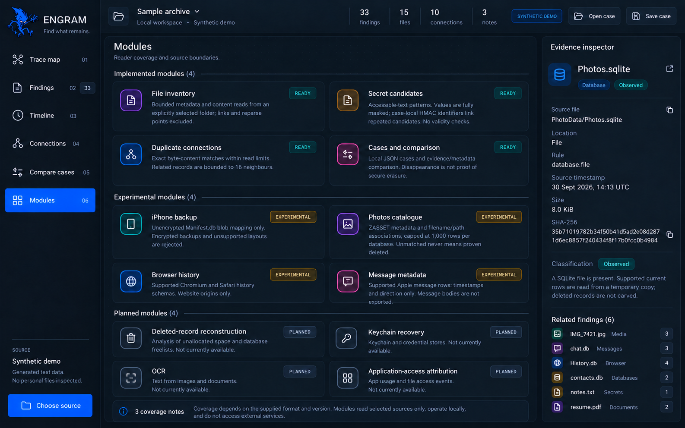
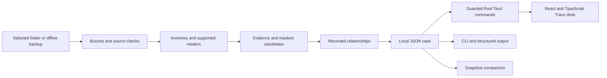

<p align="center"></p>

<p align="center">
  <a href="https://github.com/Forem0/ENGRAM/actions/workflows/ci.yml"></a>
  <a href="https://github.com/Forem0/ENGRAM/releases/tag/v0.3.0"></a>
  
  
  
  <a href="LICENSE"></a>
</p>

<p align="center"><strong>Find what remains.</strong><br/>A local desktop app for the traces preserved in your files and backups.</p>

<p align="center"><a href="https://github.com/Forem0/ENGRAM/releases/tag/v0.3.0">Get ENGRAM</a> · <a href="#get-started">Get started</a> · <a href="#a-tour-of-the-app">App tour</a> · <a href="#supported-data">Supported data</a> · <a href="docs/COMMANDS.md">CLI</a> · <a href="docs/PRIVACY.md">Privacy</a></p>

## Your files have a history. Follow it.

ENGRAM examines the offline sources you choose and turns their readable contents into a navigable case. Find media and documents, inspect masked secret candidates, follow exact-copy relationships, and compare observations over time.

The **Trace desk** brings the map, findings, timeline, connections and evidence inspector into one native application. The current **0.4.0** source implements the **Atlas Focus** graphite-and-cobalt interface, with a compact workspace header, readable file relationships and a persistent inspector. Save a case locally and reopen it without rescanning the original source. The desktop and command-line tool share the same Rust analysis engine.



The gallery presents the selected **Atlas Focus** design using illustrative synthetic data. The current source implements this visual direction; download links and native capture evidence follow verified release artifacts. The **0.3.0** packages retain their released interface. [Actual native application captures and verification](assets/screenshots/README.md) remain available alongside the [design gallery](assets/design/atlas-focus/README.md).

| Start with a question | Follow the evidence |
| --- | --- |
| What is in this folder or backup? | Browse categories and inspect each finding's source path and rule. |
| Are there matching copies? | Open recorded relationships and compare exact-content evidence. |
| Did text exports retain secret-like values? | Review fully masked candidates and the detector that identified them. |
| What changed between observations? | Load a baseline case and inspect added, removed or changed findings. |
| How much of this source was covered? | Read module states, file counters and coverage notes together. |

## Get started

### 1. Download the app

Download [ENGRAM 0.3.0](https://github.com/Forem0/ENGRAM/releases/tag/v0.3.0) for your platform. Each package contains the native desktop app and the `engram` CLI.

| Platform | Package | Runtime |
| --- | --- | --- |
| Windows x64 | Portable ZIP with desktop and CLI | Microsoft Edge WebView2 Runtime |
| macOS Apple Silicon | Archive containing `ENGRAM.app` and CLI | macOS on arm64 |
| Linux x64 | Binary tar archive with desktop and CLI | Graphical session, GTK 3 and WebKitGTK 4.1 |

Extract the archive before opening the application. Packages include SHA-256 checksums and build provenance. Current distribution packages are unsigned; the macOS app is not notarized. See [platform requirements and building](docs/BUILDING.md) for details.

### 2. Open the Trace desk

Launch `engram-desktop.exe` on Windows, `ENGRAM.app` on macOS, or `engram-desktop` on Linux. The initial case is a clearly marked synthetic demonstration, so you can explore every view before choosing a source.

### 3. Choose a source

Select **Choose source** and pick a folder in the native dialog. Use an ordinary directory, a local export, or a supported unencrypted iPhone backup directory. The app inspects that selection and replaces the demonstration with its resulting case.

For an existing ENGRAM case, use **Open case** instead. Reopening a case validates its saved data; it does not read the original source again.

### 4. Narrow the view

Select a category on the Trace map or use the category tabs. Search by name, path or rule, select a confidence label, or enable **Linked only** to focus on related artifacts. Select a result to keep its evidence beside the workspace.

### 5. Read the context

Check the source locator, evidence fields and rule in the inspector. Switch to **Modules** to see which readers ran, what they support and which files were skipped. A partial inspection remains useful when its limits are visible.

### 6. Save the observation

Use **Save case** and choose a new filename outside the inspected source. Cases are local JSON files. Existing outputs are not overwritten; choose a new name for the next observation.

### 7. Compare a later case

Inspect the source again or open a newer saved case. Go to **Compare**, select **Choose baseline**, and pick the earlier case. The open case is the current observation; the selected file is the baseline.

## A tour of the app

### Findings — a source behind every row

Search across names, paths, origins and rules. Combine category and confidence filters, then open a finding to inspect its locator, available timestamp, content hash where retained, and evidence fields.



The table is paginated, and filters apply to the actual case. The map shows a bounded set of representative nodes while category counts include every finding. No invented exposure score is needed to explain why a result exists.

### Timeline — dates with their meaning intact

Move between newest-first and oldest-first views. Dated findings retain their source context; the view also reports how many findings have no usable timestamp.



A filesystem modification time is a modification time. A supported database timestamp is labelled according to its reader. The interface does not turn either into an assumed deletion date.

### Connections — inspect what links two artifacts

Follow relationships recorded by the engine, including identical file content and repeated masked candidates within a case. Select either endpoint to review its own source evidence.



Links reflect implemented evidence rules. The decorative map guides add no findings or relationships, and a visual connection is not a claim that another application accessed a file.

### Compare — two observations, one clear difference

Choose an earlier case as the baseline and inspect **Added**, **Removed**, **Changed** and **Unchanged** groups. Findings removed from the current observation can still be inspected using their baseline evidence.



The design shows the baseline-selection state before a comparison is loaded. Comparison describes the supplied snapshots; different dates, read limits or parser coverage can change the result. A missing finding does not establish that every copy was securely erased.

### Modules — coverage belongs next to the results

See **Ready**, **Experimental**, **Planned** and **Unavailable** states for the active source, alongside skipped-file counters and inspection notes.



These states describe the actual reader and supplied format. An unsupported schema stays visible as a limitation; it does not silently become a successful empty inspection.

## Supported data

### Files, archives and local exports

Choose an accessible folder to inventory eligible media, documents and databases. Files that can be read within the configured bounds can contribute content hashes and exact-copy relationships. Archives should be extracted into a separate folder before selection; ENGRAM does not promise to unpack arbitrary container formats.

This workflow is useful for an old export directory, a copied application-data folder or a controlled before-and-after dataset. The original source is not an output destination.

### Unencrypted iPhone backups

Select the local backup directory containing a supported `Manifest.db`. The engine maps supported backup blobs to logical paths and attempts best-effort associations with supported Photos catalogue records and thumbnail paths.

A backup is a snapshot with its own coverage. Plugging in a phone does not expose its private filesystem, iCloud-only content may be absent, and an unlinked thumbnail is a candidate for review rather than proof of a deleted original. Encrypted backups are reported as unavailable.

### Secret candidates in accessible text

Supported patterns include credential-style assignments, token-shaped strings, access-key-shaped strings, JWT-shaped strings and private-key blocks. Values are fully masked before they enter persistent findings or events.

Within-case matching can connect repeated candidates without storing their raw values. The tool does not sign in, test a token, unlock Keychain or determine whether a candidate is still valid.

### Browser and message metadata

Supported Chromium and Safari history schemas provide website-origin metadata. Private URL components and page titles are omitted. Supported Apple message rows contribute timestamps and direction; message bodies and contacts are not exported.

Readers work from temporary database copies and available supported sidecars. A copied WAL can preserve the database state visible to SQLite; deleted-record carving is a separate planned capability.

### Capability matrix

| Module | State | Current behavior |
| --- | --- | --- |
| Folder inventory | **Ready** | bounded metadata/content reads, source counters and skip notes |
| Secret candidates | **Ready** | supported text patterns, fully masked values and within-case matching |
| Duplicate relationships | **Ready** | exact-content relationships for eligible readable files |
| Cases and comparison | **Ready** | local JSON persistence, reopening and snapshot differences |
| iPhone backup index | **Experimental** | supported unencrypted `Manifest.db` mapping |
| Photos association | **Experimental** | supported catalogue rows and best-effort filename/path links |
| Browser activity | **Experimental** | supported Chromium and Safari schemas; website origins only |
| Message metadata | **Experimental** | supported Apple message rows; timestamp and direction only |
| Deleted-record / WAL carving | **Planned** | deleted-record reconstruction is not implemented |
| Keychain recovery | **Planned** | protected-vault unlocking and arbitrary deleted-password recovery are not implemented |
| Location / OCR | **Planned** | coordinate extraction and image-text recognition are not implemented |
| Application access attribution | **Planned** | no inference of a past read or transmission from a permission or artifact |

Experimental readers may handle a supported source while remaining incomplete across OS and application versions. The [methodology](docs/METHODOLOGY.md) explains association rules, timestamps and interpretation.

## Use the same engine from the terminal

Release packages include the `engram` CLI. From a source checkout, install it with `cargo install --path crates/engram-cli --locked`, or replace `engram` below with `cargo run -p engram-cli --`.

### Check the environment and explore a demo

```bash
engram doctor
engram demo --out ./demo.engram.json
engram inspect ./demo.engram.json
```

`doctor` reports the build, platform and default limits. The demo is generated from synthetic source files and processed by the real engine; saved demonstration cases retain their demo label.

### Inspect an explicitly selected folder

```bash
engram scan ./selected-source --out ./source.engram.json
engram inspect ./source.engram.json --json
```

The source argument is required. No computer-wide source discovery runs in the background. The case destination must be new and outside the selected source directory.

### Make a reproducible test source

```bash
engram fixture ./sample-source
engram scan ./sample-source --out ./before.engram.json
# Modify a synthetic file, then inspect the same test source again.
engram scan ./sample-source --out ./after.engram.json
engram compare ./before.engram.json ./after.engram.json
```

Use a new fixture destination. This command creates synthetic source material; ordinary scan and inspect commands preserve source evidence.

### Export structured results

```bash
engram inspect ./after.engram.json --json > case-output.json
engram compare ./before.engram.json ./after.engram.json \
  --out ./comparison.json --json
```

`--json` emits one structured value to stdout. Errors go to stderr with a nonzero exit status. `compare --out` writes a separate comparison document; it does not replace either input case.

### Set inspection bounds

```bash
engram scan ./selected-source --out ./bounded.engram.json \
  --max-files 5000 \
  --max-file-bytes 4194304 \
  --max-total-bytes 134217728 \
  --skip-hidden
```

Defaults are **25,000 files**, **8 MiB per file** and **512 MiB total source bytes**. Hidden text such as `.env` is eligible unless `--skip-hidden` is set. Additional traversal, database, work-budget and imported-case limits apply; see the [complete bounds](docs/METHODOLOGY.md#source-selection-and-boundaries) and [command reference](docs/COMMANDS.md).

## What a case preserves

A case records the source type, inspection times, counters, reader states, warnings, events and findings. Each finding carries its source path, locator, rule, available evidence and related IDs.

| Confidence | Meaning |
| --- | --- |
| **Observed** | A supported reader observed this artifact in the supplied source. |
| **Linked** | An implemented evidence rule established a relationship. |
| **Candidate** | A pattern or incomplete association needs review. |

Case schema 1 is shared by the desktop and CLI. Opening a case validates its structure without probing the source paths stored inside it. Comparison follows exported observations and relationships; case-local secret fingerprints do not establish the continuity or validity of a secret across scans.

## Local by design

Analysis does not contact a model, credential endpoint, breach database or telemetry service. The desktop ships its React assets locally and uses a narrow Rust command bridge for source selection, analysis and case persistence.

Source readers do not intentionally alter the selected evidence. Symlinks and Windows reparse points do not broaden the selection. SQLite readers parse working copies. The app does not attach to a live browser, bypass device protections or delete data from a phone.

Saved cases are plaintext JSON and remain sensitive: paths, website origins, filenames, dates and relationships can reveal personal activity even when candidate values are masked. Keep them private and use generated fixtures in public bug reports. Read the [privacy boundaries](docs/PRIVACY.md).

## How it fits together



| Layer | Responsibility |
| --- | --- |
| Rust core | source classification, bounded readers, evidence, masking, relationships and case validation |
| Rust Tauri backend | native dialogs, active-case session, guarded background operations and persistence |
| React / TypeScript | six workspace views, shared filters, navigation and evidence presentation |
| CLI | explicit source commands, repeatable workflows and structured output |

The renderer is not given a general filesystem or shell API. A cancelled dialog leaves the open case in place; a failed operation reports its error without quietly replacing the case with a demo. See [architecture](docs/ARCHITECTURE.md).

## Build from source

Use **Node.js 24**, a Rust toolchain compatible with the workspace, a C compiler and the [platform prerequisites](docs/BUILDING.md). Both lockfiles are committed.

```bash
git clone https://github.com/Forem0/ENGRAM.git
cd ENGRAM/apps/desktop
npm ci
npm run tauri -- dev -- -- --demo
```

The Tauri CLI starts the frontend and native Rust process together. For a production package:

```bash
npm run tauri -- build --ci -- --locked
```

`npm run dev` alone starts a browser-only synthetic layout demonstration. Real source dialogs, case persistence and baseline selection require the native app. Browser captures are separate from native execution evidence.

### Development checks

From the repository root:

```bash
cargo fmt --all -- --check
cargo test -p engram-core -p engram-cli --locked
cd apps/desktop
npm ci
npm run format:check
npm run typecheck
npm test
npm run build
cd ../..
cargo test -p engram-desktop --features engram-desktop/custom-protocol --locked
cargo clippy --workspace --all-targets --features engram-desktop/custom-protocol --locked -- -D warnings
```

Tests use synthetic sources. CI checks the Rust workspace on Windows, macOS and Linux, verifies the frontend, and separately launches real Tauri/WebKit windows under a Linux display to exercise the renderer-to-Rust path. Native build and capture evidence belongs with the release it describes.

## Next work

The current app already supports the folder-to-case workflow, local persistence and comparison. Next priorities are broader reader fixtures and compatibility coverage, clearer source-specific diagnostics, keyboard/accessibility refinements, and platform signing and notarization.

Deleted-record reconstruction, owner-unlocked encrypted backups and optional local OCR remain research items. They need reproducible evidence and explicit support boundaries before moving into the working capability matrix. See the [roadmap](docs/ROADMAP.md).

## Explore the repository

```text
crates/engram-core/       readers, bounds, evidence, masking and case model
crates/engram-cli/        terminal commands and structured output
apps/desktop/src/         React/TypeScript Trace desk and typed bridge
apps/desktop/src-tauri/   native Tauri shell, dialogs and Rust session
assets/                  brand artwork and real application captures
docs/                    methodology, privacy, commands and building
.github/workflows/       checks and manually requested native packages
```

| Read next | Purpose |
| --- | --- |
| [Commands](docs/COMMANDS.md) | complete CLI options and exit statuses |
| [Methodology](docs/METHODOLOGY.md) | evidence rules, read bounds and timestamp meanings |
| [Architecture](docs/ARCHITECTURE.md) | case flow, IPC commands and component ownership |
| [Privacy](docs/PRIVACY.md) | local-data boundaries and safe case handling |
| [Building](docs/BUILDING.md) | toolchains, runtime dependencies and native capture verification |
| [Changelog](CHANGELOG.md) | version history and release evidence |

Contributions should improve a working behavior and keep its evidence reviewable. New readers need a documented format, a synthetic fixture and meaningful failure cases. Use [contribution guidance](CONTRIBUTING.md) and [security reporting](SECURITY.md); keep personal backups and real credentials out of issues and pull requests.

## License

[MIT](LICENSE). Built for people who want to understand the traces in their own data.
