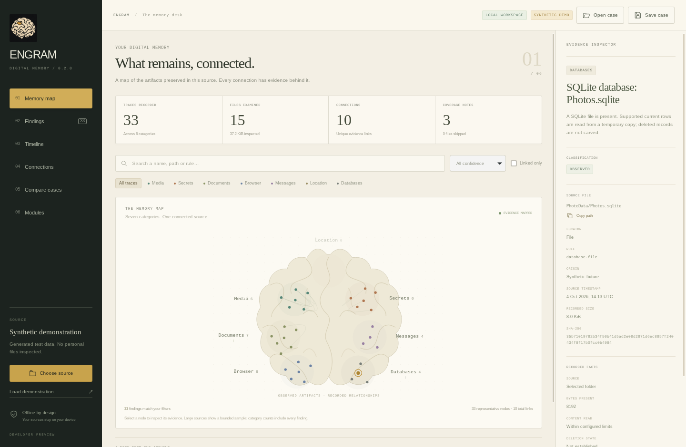
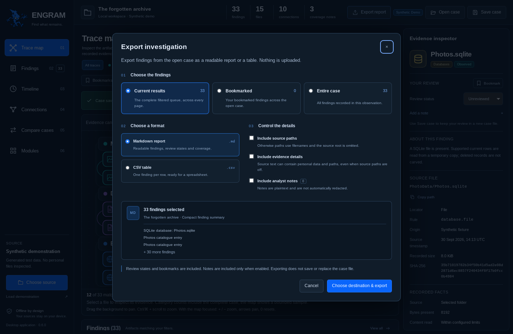
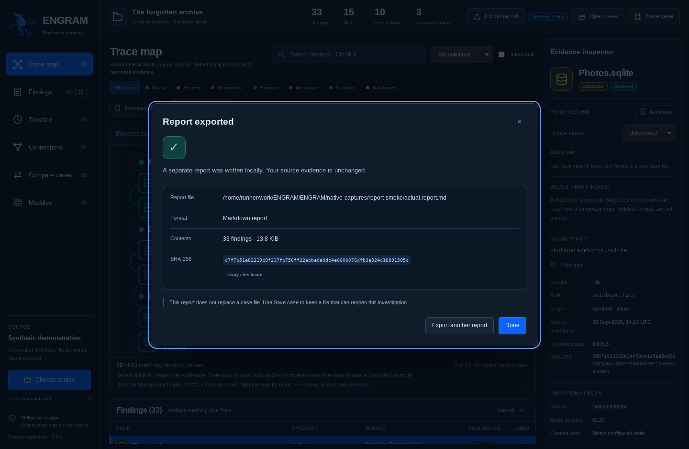
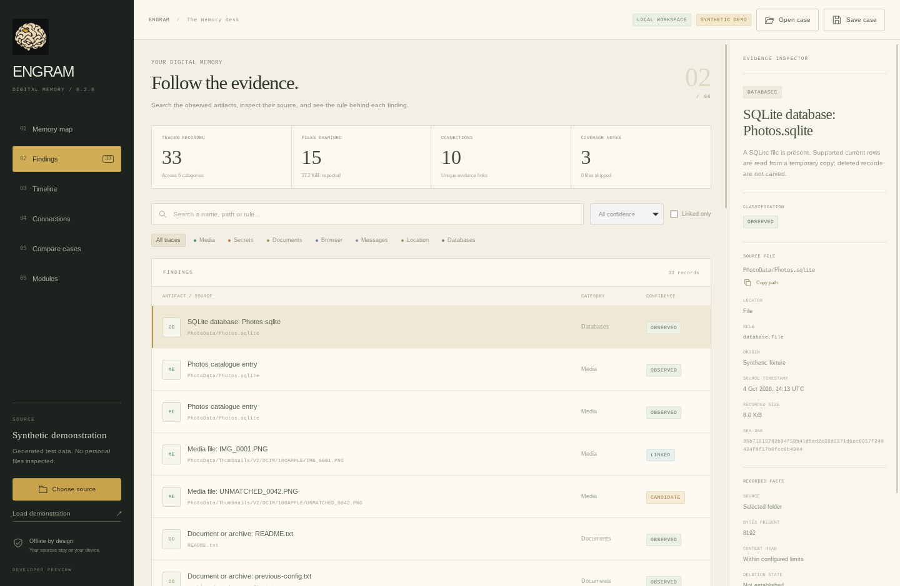
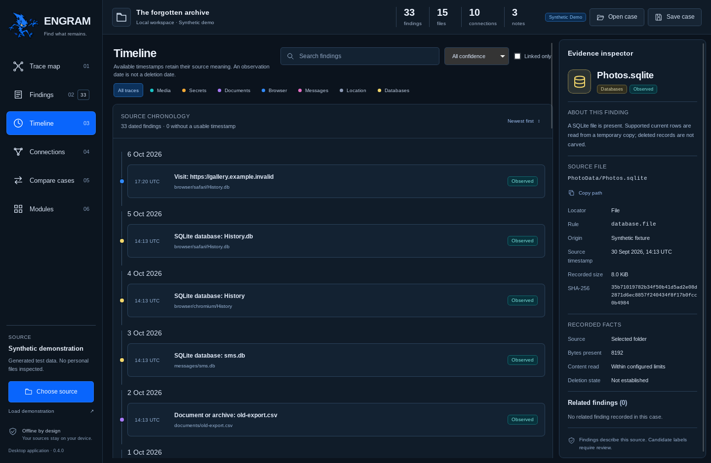
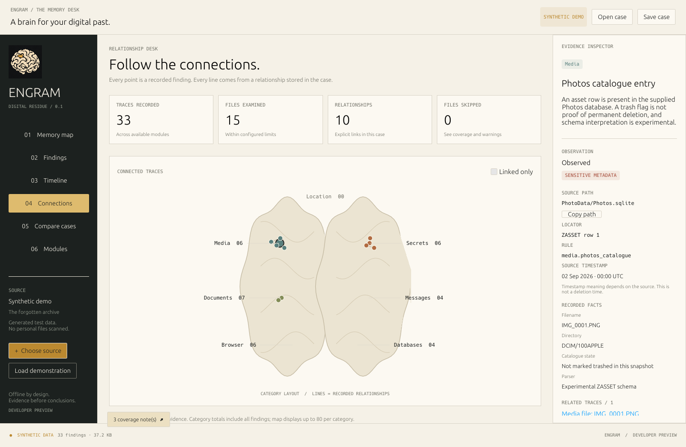
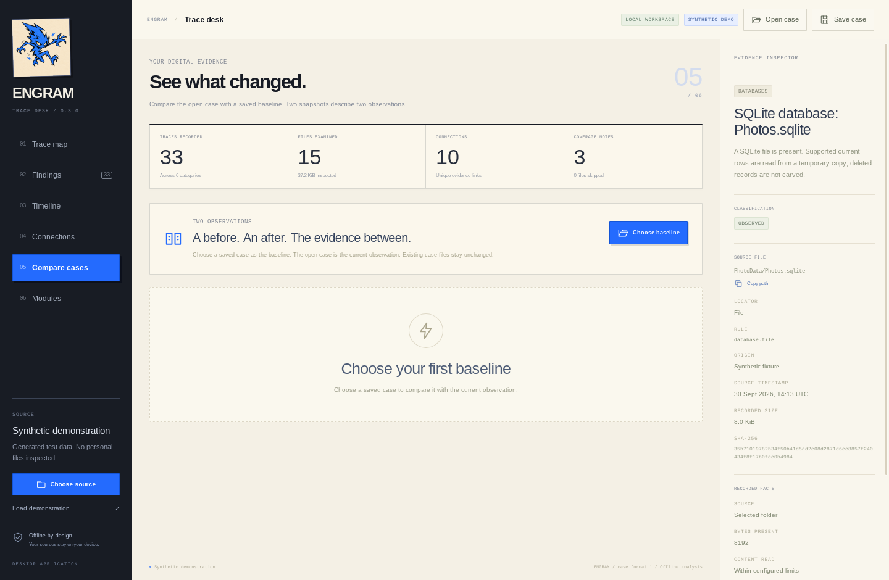
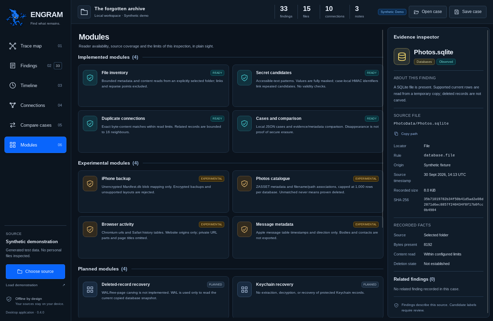
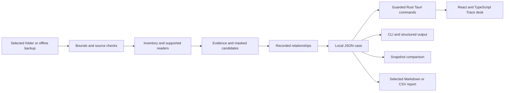

<p align="center"></p>

<p align="center">
  <a href="https://github.com/Forem0/ENGRAM/actions/workflows/ci.yml"></a>
  <a href="https://github.com/Forem0/ENGRAM/releases/tag/v0.6.0"></a>
  
  
  
  <a href="LICENSE"></a>
</p>

<p align="center"><strong>Find what remains.</strong><br/>A local desktop app for the traces preserved in your files and backups.</p>

<p align="center"><a href="https://github.com/Forem0/ENGRAM/releases/tag/v0.6.0">Get ENGRAM</a> · <a href="#get-started">Get started</a> · <a href="#a-tour-of-the-app">App tour</a> · <a href="#supported-data">Supported data</a> · <a href="docs/COMMANDS.md">CLI</a> · <a href="docs/PRIVACY.md">Privacy</a></p>

## Your files have a history. Follow it.

ENGRAM examines the offline sources you choose and turns their readable contents into a navigable case. Find media and documents, inspect masked secret candidates, follow exact-copy relationships, and compare observations over time.

The **Trace desk** brings the map, findings, timeline, connections and evidence inspector into one native application. **ENGRAM 0.6.0** extends the **Atlas Focus** review workspace with Markdown and CSV evidence reports. Keep finding bookmarks, review states and plain-text notes beside the evidence, search with structured queries, and navigate the pannable, zoomable map. Save a case locally and reopen it without rescanning the original source. The desktop and command-line tool share the same Rust analysis engine.

Export the complete filtered queue, bookmarked findings or the entire case. Choose Markdown or CSV, opt in to notes, recorded paths and source details independently, and keep a SHA-256 receipt for the report. Exporting preserves the open case and its unsaved review.



The six workspace views and report screens were captured on Linux from the actual **0.6.0** Tauri application, using synthetic files processed by the shared Rust engine. The [successful native Tauri/IPC job](https://github.com/Forem0/ENGRAM/actions/runs/40874129225/job/123451027724) exercised [source 9c7d9c3](https://github.com/Forem0/ENGRAM/commit/9c7d9c3e1e65b9ce95d597b3f59dc41a885afeaa); the [verification run](https://github.com/Forem0/ENGRAM/actions/runs/40874129225) records all seven passing checks. [Capture provenance](assets/screenshots/README.md) records the exact images, checkout and report evidence. The original [Atlas Focus design gallery](assets/design/atlas-focus/README.md) remains a separate visual reference.

| Start with a question | Follow the evidence |
| --- | --- |
| What is in this folder or backup? | Browse categories and inspect each finding's source path and rule. |
| Are there matching copies? | Open recorded relationships and compare exact-content evidence. |
| Did text exports retain secret-like values? | Review fully masked candidates and the detector that identified them. |
| What changed between observations? | Load a baseline case and inspect added, removed or changed findings. |
| How much of this source was covered? | Read module states, file counters and coverage notes together. |
| What needs another look? | Bookmark findings, mark review states and keep plain-text notes with the saved case. |
| How can I share selected observations? | Export the current queue, bookmarks or the entire case with independent privacy options and a checksum receipt. |

## Get started

### 1. Download the app

Download [ENGRAM 0.6.0](https://github.com/Forem0/ENGRAM/releases/tag/v0.6.0) for your platform. Each package contains the native desktop app and the `engram` CLI.

| Platform | Package | Runtime |
| --- | --- | --- |
| Windows x64 | Portable ZIP with desktop and CLI | Microsoft Edge WebView2 Runtime |
| macOS Apple Silicon | Archive containing `ENGRAM.app` and CLI | macOS on arm64 |
| Linux x64 | Binary tar archive with desktop and CLI | Graphical session, GTK 3 and WebKitGTK 4.1 |

Extract the archive before opening the application. Packages include SHA-256 checksums and build provenance. Current distribution packages are unsigned; the macOS app is not notarized. See [platform requirements and building](docs/BUILDING.md) for details.

### 2. Open the Trace desk

Launch `engram-desktop.exe` on Windows, `ENGRAM.app` on macOS, or `engram-desktop` on Linux. The initial case is a clearly marked synthetic demonstration, so you can explore every view before choosing a source.

### 3. Choose a source

Select **Choose source** and pick a folder in the native dialog. Use an ordinary directory, a local export, or a supported unencrypted iPhone backup directory. The app inspects that selection and replaces the demonstration with its resulting case.

For an existing ENGRAM case, use **Open case** instead. Reopening a case validates its saved data; it does not read the original source again.

### 4. Narrow the view

Select a category on the Trace map or use the category tabs. Search by name, path or rule, select a confidence label, or enable **Linked only** to focus on related artifacts. Select a result to keep its evidence beside the workspace.

### 5. Read the context

Check the source locator, evidence fields and rule in the inspector. Use **Your review** to bookmark the current finding, choose **Unreviewed**, **Needs review** or **Reviewed**, and add a plain-text note. Review status is your annotation; **Observed**, **Linked** and **Candidate** remain the engine's confidence labels.

Switch to **Modules** to see which readers ran, what they support and which files were skipped. A partial inspection remains useful when its limits are visible.

### 6. Save the observation

Use **Save case** and choose a new filename outside the inspected source. Cases are local JSON files. Bookmarks, review states and notes are kept with the saved case. Existing outputs are not overwritten; choose a new name for the next observation.

The **Unsaved review** indicator stays visible until the changed review is saved. Before switching the open case or closing the desktop, the app offers to save, continue without saving or keep working. Cancelling or failing a save keeps the review unsaved. In the browser demonstration, review changes stay in the current tab and do not become a saved case.

### 7. Compare a later case

Inspect the source again or open a newer saved case. Go to **Compare**, select **Choose baseline**, and pick the earlier case. The open case is the current observation; the selected file is the baseline.

### 8. Export selected findings

Use **Export report**, choose **Current results**, **Bookmarked** or **Entire case**, then select Markdown or CSV. Review the finding count and optional fields before choosing a new destination outside the source folder. The completed export shows a SHA-256 receipt. Use **Save case** separately to keep a restorable observation and any review changes.

## Review, search and navigate

### Keep your review with the evidence

Select a finding and use **Your review** in the inspector. Bookmarks are independent of the review state, so a bookmarked finding can be **Unreviewed**, **Needs review** or **Reviewed**. **Add a note** edits the current finding's plain-text note. Use **Bookmarks** and the review-state filter to focus the queue; the toolbar's review totals describe the complete open case.

These annotations stay separate from recorded source evidence. They do not change a finding's confidence, hash, relationship or snapshot-difference result. Notes and marks from a comparison baseline can be inspected but are read-only; editing applies to the open current case.

Use **Save case** to persist the review in a new local case file. There is no automatic browser storage or cloud synchronization.

### Search with phrases, fields and exclusions

Every term must match. Put a phrase in double quotes and prefix a term with `-` to exclude it. Search is literal and case-insensitive; unknown operators and unsupported values remain literal text rather than becoming query-built regular expressions.

| Query | Meaning |
| --- | --- |
| `category:media -path:cache` | Media findings whose source path does not contain `cache`. |
| `confidence:candidate is:bookmarked` | Bookmarked candidate findings. |
| `note:"previous config" -is:reviewed` | The phrase appears in your note and the finding is not marked reviewed. |
| `has:note is:needs_review` | Findings with a note that you marked for further review. |
| `rule:secret origin:fixture` | Both supported literal field tests must match. |

Supported fields are `category`, `confidence`, `path`, `rule`, `origin` and `note`. Review predicates are `is:bookmarked`, `is:reviewed`, `is:needs_review`, `is:unreviewed` and `has:note`. Category values use the singular internal names `media`, `secret`, `document`, `browser`, `message`, `location` and `database`. Ordinary text also searches your notes. An incomplete quoted phrase shows a query error until it is closed.

Queries are bounded to 2,048 characters and 128 terms.

### Move around the Trace map

Drag the map background to pan. Use **+** and **−**, or **Ctrl/⌘ + scroll**, to zoom between 60% and 250%. The percentage button resets the map to 100%; **Fit selection** brings the selected finding into view. Ordinary scrolling remains page scrolling.

With the map focused, the arrow keys pan, **+ / −** zoom, and **0** or **Home** reset the view. Selecting a finding from the map, table or related-items list keeps the evidence inspector on that actual record. Map navigation changes the viewport and adds no evidence links.

| Shortcut | Action |
| --- | --- |
| **Ctrl/⌘ K** | Focus the shared search field. |
| **Ctrl/⌘ S** | Save a new case in the desktop app. |
| **B** | Toggle the selected current finding's bookmark. |
| **R** | Toggle Reviewed / Unreviewed for the selected current finding. |
| **1–6** | Switch workspace views. |
| **?** | Open Search & shortcuts. |

Letter shortcuts stay inactive while typing. Saved-case selection and persistence use the native desktop application.

## Export findings from a case

Use **Export report** in the Trace desk. In **Export investigation**, choose **Current results**, **Bookmarked** or **Entire case**, then select **Markdown report** or **CSV table**. Current results include the full filtered queue, rather than only the visible page or representative map nodes. An empty scope cannot silently become an export of the whole case.



The export starts with a minimal set of finding fields. The structured path field is reduced to a filename; the source root, analyst notes and source-derived detail fields are omitted. Opt in separately to full recorded paths, evidence details or notes. Path settings do not anonymize arbitrary source text: details can contain private text or paths, and notes are the plain text you entered without automatic redaction. Titles, filenames, dates, IDs and hashes can still identify activity, so a report remains a sensitive local artifact.

Select **Choose destination & export** to open the native save dialog for a new file outside source evidence. A successful export returns its format, finding count, byte count and SHA-256 checksum. Cancelled or failed exports preserve the open case and its review. Export uses the current review in the desktop; it does **not** mark an unsaved review as saved. Use **Save case** to retain changes in a case you can reopen.



Markdown is escaped as report text, and CSV uses UTF-8 with a BOM, quoted fields and CRLF records. Spreadsheet formula prefixes in text cells are neutralized. CSV refuses provenance identifiers that would require formula rewriting; choose Markdown for those cases. Both formats preserve the engine's confidence labels and describe the selected observation; neither format is a restorable ENGRAM case or evidence of secure deletion. Reports contain at most 10,000 selected findings and 16 MiB of output, with an explicit error rather than truncation when a bound is exceeded.

The browser demonstration can show export options against the synthetic case. Writing a report requires the native application. The [Linux native report exercise](https://github.com/Forem0/ENGRAM/actions/runs/40874129225/job/123451027724) used real destination pickers, cancelled one export, and wrote Markdown and CSV reports matching the CLI output for the same saved synthetic case. The receipt above shows that actual Markdown output; the broader evidence scope is recorded in [building and verification](docs/BUILDING.md#native-report-interaction).

## A tour of the app

### Findings — a source behind every row

Search across names, paths, origins and rules. Combine category and confidence filters, then open a finding to inspect its locator, available timestamp, content hash where retained, and evidence fields.



The table is paginated, and filters apply to the actual case. The map shows a bounded set of representative nodes while category counts include every finding. No invented exposure score is needed to explain why a result exists.

### Timeline — dates with their meaning intact

Move between newest-first and oldest-first views. Dated findings retain their source context; the view also reports how many findings have no usable timestamp.



A filesystem modification time is a modification time. A supported database timestamp is labelled according to its reader. The interface does not turn either into an assumed deletion date.

### Connections — inspect what links two artifacts

Follow relationships recorded by the engine, including identical file content and repeated masked candidates within a case. Select either endpoint to review its own source evidence.



Links reflect implemented evidence rules. The decorative map guides add no findings or relationships, and a visual connection is not a claim that another application accessed a file.

### Compare — two observations, one clear difference

Choose an earlier case as the baseline and inspect **Added**, **Removed**, **Changed** and **Unchanged** groups. Findings removed from the current observation can still be inspected using their baseline evidence.



The capture shows the baseline-selection state before a comparison is loaded. Comparison describes the supplied snapshots; different dates, read limits or parser coverage can change the result. A missing finding does not establish that every copy was securely erased.

### Modules — coverage belongs next to the results

See **Ready**, **Experimental**, **Planned** and **Unavailable** states for the active source, alongside skipped-file counters and inspection notes.



These states describe the actual reader and supplied format. An unsupported schema stays visible as a limitation; it does not silently become a successful empty inspection.

## Supported data

### Media gallery and guided iPhone inspection — 0.7 source development

The 0.7 source adds **Media gallery**, a seventh workspace view for recorded media files, thumbnail-path evidence and Photos catalogue rows. Filter the gallery, select a finding and request **Preview image** for supported PNG or JPEG bytes from a source explicitly scanned in the current desktop session. The native engine verifies the recorded SHA-256 and generates a bounded, metadata-stripped PNG. Images are kept in memory and are not embedded in case files or reports.

**Inspect iPhone backup** opens a guided workflow: choose a backup folder through the native picker, review its encryption state and supported index, then explicitly start analysis. Listed category counts describe the index, while the resulting **Modules** view reports actual reader coverage. Cancelling the picker or wizard keeps the current case and review.

These additions are in the 0.7 source branch; the published **0.6.0** downloads linked above retain their original features and verification. Read the [media and backup workflow](docs/MEDIA.md) for formats, bounds, source authorization and synthetic testing. OCR and encrypted-backup reading remain separate research items.

### Files, archives and local exports

Choose an accessible folder to inventory eligible media, documents and databases. Files that can be read within the configured bounds can contribute content hashes and exact-copy relationships. Archives should be extracted into a separate folder before selection; ENGRAM does not promise to unpack arbitrary container formats.

This workflow is useful for an old export directory, a copied application-data folder or a controlled before-and-after dataset. The original source is not an output destination.

### Unencrypted iPhone backups

Select the local backup directory containing a supported `Manifest.db`. The engine maps supported backup blobs to logical paths and attempts best-effort associations with supported Photos catalogue records and thumbnail paths.

A backup is a snapshot with its own coverage. Plugging in a phone does not expose its private filesystem, iCloud-only content may be absent, and an unlinked thumbnail is a candidate for review rather than proof of a deleted original. Encrypted backups are reported as unavailable.

### Secret candidates in accessible text

Supported patterns include credential-style assignments, token-shaped strings, access-key-shaped strings, JWT-shaped strings and private-key blocks. Values are fully masked before they enter persistent findings or events.

Within-case matching can connect repeated candidates without storing their raw values. The tool does not sign in, test a token, unlock Keychain or determine whether a candidate is still valid.

### Browser and message metadata

Supported Chromium and Safari history schemas provide website-origin metadata. Private URL components and page titles are omitted. Supported Apple message rows contribute timestamps and direction; message bodies and contacts are not exported.

Readers work from temporary database copies and available supported sidecars. A copied WAL can preserve the database state visible to SQLite; deleted-record carving is a separate planned capability.

### Capability matrix

| Module | State | Current behavior |
| --- | --- | --- |
| Folder inventory | **Ready** | bounded metadata/content reads, source counters and skip notes |
| Secret candidates | **Ready** | supported text patterns, fully masked values and within-case matching |
| Duplicate relationships | **Ready** | exact-content relationships for eligible readable files |
| Cases and comparison | **Ready** | local JSON persistence, reopening and snapshot differences |
| iPhone backup index | **Experimental** | supported unencrypted `Manifest.db` mapping |
| Photos association | **Experimental** | supported catalogue rows and best-effort filename/path links |
| Browser activity | **Experimental** | supported Chromium and Safari schemas; website origins only |
| Message metadata | **Experimental** | supported Apple message rows; timestamp and direction only |
| Deleted-record / WAL carving | **Planned** | deleted-record reconstruction is not implemented |
| Keychain recovery | **Planned** | protected-vault unlocking and arbitrary deleted-password recovery are not implemented |
| Location / OCR | **Planned** | coordinate extraction and image-text recognition are not implemented |
| Application access attribution | **Planned** | no inference of a past read or transmission from a permission or artifact |

Experimental readers may handle a supported source while remaining incomplete across OS and application versions. The [methodology](docs/METHODOLOGY.md) explains association rules, timestamps and interpretation.

## Use the same engine from the terminal

Release packages include the `engram` CLI. From a source checkout, install it with `cargo install --path crates/engram-cli --locked`, or replace `engram` below with `cargo run -p engram-cli --`.

### Check the environment and explore a demo

```bash
engram doctor
engram demo --out ./demo.engram.json
engram inspect ./demo.engram.json
```

`doctor` reports the build, platform and default limits. The demo is generated from synthetic source files and processed by the real engine; saved demonstration cases retain their demo label.

### Inspect an explicitly selected folder

```bash
engram scan ./selected-source --out ./source.engram.json
engram inspect ./source.engram.json --json
```

The source argument is required. No computer-wide source discovery runs in the background. The case destination must be new and outside the selected source directory.

### Make a reproducible test source

```bash
engram fixture ./sample-source
engram scan ./sample-source --out ./before.engram.json
# Modify a synthetic file, then inspect the same test source again.
engram scan ./sample-source --out ./after.engram.json
engram compare ./before.engram.json ./after.engram.json
```

Use a new fixture destination. This command creates synthetic source material; ordinary scan and inspect commands preserve source evidence.

### Export structured results

```bash
engram inspect ./after.engram.json --json > case-output.json
engram compare ./before.engram.json ./after.engram.json \
  --out ./comparison.json --json
```

`--json` emits one structured value to stdout. Errors go to stderr with a nonzero exit status. `compare --out` writes a separate comparison document; it does not replace either input case.

The CLI also exports reports from a saved case:

```bash
engram export ./after.engram.json --out ./findings.report.md
engram export ./after.engram.json --out ./bookmarks.csv --format csv --bookmarked
engram export ./after.engram.json --out ./selected.report.md \
  --finding <finding-id> --finding <another-finding-id> --json
```

Use `--include-notes`, `--include-paths` and `--include-details` only for fields you intend to retain in the report. Explicit IDs and `--bookmarked` are mutually exclusive. The CLI reads review metadata already saved in the supplied case; it cannot see unsaved changes in an open desktop window. See the [export command reference](docs/COMMANDS.md#export).

### Set inspection bounds

```bash
engram scan ./selected-source --out ./bounded.engram.json \
  --max-files 5000 \
  --max-file-bytes 4194304 \
  --max-total-bytes 134217728 \
  --skip-hidden
```

Defaults are **25,000 files**, **8 MiB per file** and **512 MiB total source bytes**. Hidden text such as `.env` is eligible unless `--skip-hidden` is set. Additional traversal, database, work-budget and imported-case limits apply; see the [complete bounds](docs/METHODOLOGY.md#source-selection-and-boundaries) and [command reference](docs/COMMANDS.md).

## What a case preserves

A case records the source type, inspection times, counters, reader states, warnings, events and findings. Each finding carries its source path, locator, rule, available evidence and related IDs.

| Confidence | Meaning |
| --- | --- |
| **Observed** | A supported reader observed this artifact in the supplied source. |
| **Linked** | An implemented evidence rule established a relationship. |
| **Candidate** | A pattern or incomplete association needs review. |

Case schema 1 is shared by the desktop and CLI. The optional `review` map stores bookmarks, review states and notes by known finding ID. Cases created before review annotations existed still open with an empty review. Each annotation is validated against the case's actual findings; empty defaults are omitted from the saved representation.

Review limits are 2,048 annotations, 4,096 UTF-8 bytes per note and 1 MiB of note text per case. Opening a case validates its structure without probing the source paths stored inside it. Older releases may ignore the optional review field; use 0.5.0 or later when saving annotations you intend to retain.

Comparison follows exported observations and relationships. Review edits alone do not become evidence changes; case-local secret fingerprints do not establish the continuity or validity of a secret across scans.

## Local by design

Analysis does not contact a model, credential endpoint, breach database or telemetry service. The desktop ships its React assets locally and uses a narrow Rust command bridge for source selection, analysis and case persistence.

Source readers do not intentionally alter the selected evidence. Symlinks and Windows reparse points do not broaden the selection. SQLite readers parse working copies. The app does not attach to a live browser, bypass device protections or delete data from a phone.

Saved cases are plaintext JSON and remain sensitive: paths, website origins, filenames, dates, relationships and your notes can reveal personal activity even when candidate values are masked. Analyst notes are stored as the plain text you enter; they are not automatically redacted by the secret detector. Keep cases private, avoid writing credentials into notes and use generated fixtures in public bug reports. Read the [privacy boundaries](docs/PRIVACY.md).

## How it fits together



| Layer | Responsibility |
| --- | --- |
| Rust core | source classification, bounded readers, evidence, masking, relationships, case validation and report rendering |
| Rust Tauri backend | native dialogs, active-case session, validated review snapshots, guarded persistence and report export |
| React / TypeScript | six workspace views, review controls, search, map navigation, evidence presentation and export options |
| CLI | explicit source commands, repeatable workflows and structured output |

The renderer is not given a general filesystem or shell API. A cancelled dialog leaves the open case in place; a failed operation reports its error without quietly replacing the case with a demo. See [architecture](docs/ARCHITECTURE.md).

## Build from source

Use **Node.js 24**, a Rust toolchain compatible with the workspace, a C compiler and the [platform prerequisites](docs/BUILDING.md). Both lockfiles are committed.

```bash
git clone https://github.com/Forem0/ENGRAM.git
cd ENGRAM/apps/desktop
npm ci
npm run tauri -- dev -- -- --demo
```

The Tauri CLI starts the frontend and native Rust process together. For a production package:

```bash
npm run tauri -- build --ci -- --locked
```

`npm run dev` alone starts a browser-only synthetic layout demonstration. Real source dialogs, case persistence, report writing and baseline selection require the native app. Browser captures are separate from native execution evidence.

### Development checks

From the repository root:

```bash
cargo fmt --all -- --check
cargo test -p engram-core -p engram-cli --locked
cd apps/desktop
npm ci
npm run format:check
npm run typecheck
npm test
npm run build
cd ../..
cargo test -p engram-desktop --features engram-desktop/custom-protocol --locked
cargo clippy --workspace --all-targets --features engram-desktop/custom-protocol --locked -- -D warnings
```

Tests use synthetic sources. The [0.6.0 verification run](https://github.com/Forem0/ENGRAM/actions/runs/40874129225) records Rust checks on Windows, macOS and Linux, frontend validation, and actual Tauri/WebKit startup and report-export interaction on Linux. The native report exercise uses the real XDG/GTK save picker, checks cancellation, and compares both exported formats byte for byte with the CLI rendering of the same saved synthetic case. Native build and capture evidence belongs with the release it describes; platform packaging is recorded by the [Build artifacts workflow](https://github.com/Forem0/ENGRAM/actions/workflows/build-artifacts.yml). See [building and verification](docs/BUILDING.md) for the evidence scope.

## Next work

ENGRAM supports the folder-to-case workflow, local persistence, review annotations, structured search, map navigation, comparison and selected-finding report export. Next priorities are broader reader fixtures and compatibility coverage, clearer source-specific diagnostics, continued accessibility checks, native interaction coverage across platforms, and platform signing and notarization.

Deleted-record reconstruction, owner-unlocked encrypted backups and optional local OCR remain research items. They need reproducible evidence and explicit support boundaries before moving into the working capability matrix. See the [roadmap](docs/ROADMAP.md).

## Explore the repository

```text
crates/engram-core/       readers, bounds, evidence, masking and case model
crates/engram-cli/        terminal commands and structured output
apps/desktop/src/         React/TypeScript Trace desk and typed bridge
apps/desktop/src-tauri/   native Tauri shell, dialogs and Rust session
assets/                  brand artwork and real application captures
docs/                    methodology, privacy, commands and building
.github/workflows/       checks and manually requested native packages
```

| Read next | Purpose |
| --- | --- |
| [Commands](docs/COMMANDS.md) | complete CLI options and exit statuses |
| [Methodology](docs/METHODOLOGY.md) | evidence rules, read bounds and timestamp meanings |
| [Architecture](docs/ARCHITECTURE.md) | case flow, IPC commands and component ownership |
| [Privacy](docs/PRIVACY.md) | local-data boundaries and safe case handling |
| [Building](docs/BUILDING.md) | toolchains, runtime dependencies and native capture verification |
| [Changelog](CHANGELOG.md) | version history and release evidence |

Contributions should improve a working behavior and keep its evidence reviewable. New readers need a documented format, a synthetic fixture and meaningful failure cases. Use [contribution guidance](CONTRIBUTING.md) and [security reporting](SECURITY.md); keep personal backups and real credentials out of issues and pull requests.

## License

[MIT](LICENSE). Built for people who want to understand the traces in their own data.
