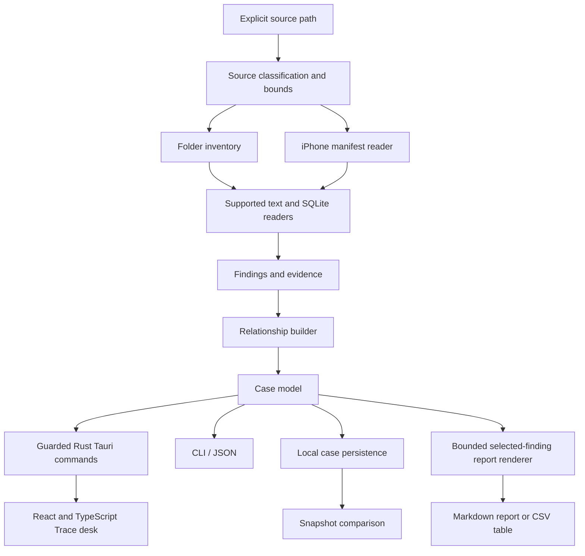
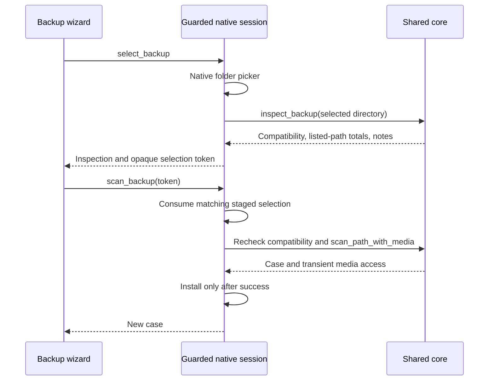

# Architecture

ENGRAM combines a shared Rust analysis workspace, a Tauri 2 native shell, and a React/TypeScript renderer. The CLI and desktop call the same core. The renderer does not contain detection rules or an unrestricted filesystem interface.

## Crates

| Crate | Responsibility |
| --- | --- |
| `engram-core` | source reads, bounds, supported parsers, candidate masking, evidence, relationships and deterministic report rendering |
| `engram-desktop` in `apps/desktop/src-tauri` | native window, Rust session, source/case dialogs and guarded IPC commands |
| `engram-cli` | explicit commands, structured output and command-line workflow boundaries |

The frontend lives in `apps/desktop/src`, with Vite configuration and npm lockfile in `apps/desktop`. Its typed bridge exchanges the validated case model with Tauri commands. Production assets are embedded in the native app; the packaged desktop does not need a local Vite server.

The public data model is in `crates/engram-core/src/model.rs`. A case has a schema version, source kind, inspection timestamps, findings, warnings, counters, module states and events. Each finding has an ID, category, source locator, rule, confidence and evidence. Relationships reference existing finding IDs.

## Data flow

1. The user chooses a source or asks for the synthetic demo.
2. The engine classifies the source and applies read bounds.
3. Readers emit evidence and candidate findings; raw secret candidates are masked before persistence.
4. Relationship construction connects artifacts using the implemented rules.
5. The desktop and CLI consume the same case.
6. Saving writes a local JSON case; reopening does not rescan the source.
7. Report export renders selected known findings from the case into a new Markdown or CSV artifact, with its own SHA-256 receipt.

Desktop scanning runs on a guarded Rust worker. The session rejects overlapping operations, and errors preserve the previous validated active case. A completed case and an error are separate outcomes; an error must not silently become a demonstration or a successful empty result.

## Native command boundary

| Command | Responsibility |
| --- | --- |
| `get_runtime_info` | report version, schema, initial view and explicit smoke-test mode |
| `load_demo` | generate the synthetic source through the real Rust engine |
| `select_source` | choose a folder in a native dialog and run bounded analysis |
| `select_backup` | choose a backup directory, inspect its index and stage the native source behind an opaque token |
| `scan_backup` | consume a staged native token, recheck compatibility, scan and replace the case only on success |
| `cancel_backup` | invalidate only the matching staged backup token |
| `preview_media` | check case/finding identity and render a bounded PNG from a scan-captured source |
| `open_case` | choose a case in a native dialog and validate it before replacing the active case |
| `save_case` | choose a destination and persist the Rust-held active case |
| `export_report` | validate a case/review snapshot and selection, choose a new native destination and return a report receipt |
| `compare_case` | choose an earlier case and compare it with the current Rust-held case |
| `finish_smoke_test` | complete an explicit synthetic native/IPC smoke launch; unavailable in normal sessions |

The main window is the authorized command caller. Commands do not accept arbitrary source paths or case objects from React to bypass native selection and validation. The production content security policy allows bundled assets and the Tauri IPC connection, without a general remote content or shell capability.

The report command accepts the expected case ID, bounded review metadata, selected finding IDs, format and three inclusion flags. It obtains all evidence from the guarded Rust-held snapshot, renders before the destination picker and rechecks the snapshot before writing. It accepts neither an arbitrary renderer-provided path nor rendered file content. A cancelled, failed or stale export leaves the case and its saved/unsaved review identity unchanged. Only Save case persists the current review as a restorable case.

Report rendering is shared with `engram export`. It rejects empty, duplicate or unknown IDs and excessive selection/output size. Markdown escapes untrusted markup; CSV has a UTF-8 BOM, RFC4180-style quoting, CRLF records and spreadsheet-formula neutralization. Defaults omit notes, source root and detail fields and reduce the structured path to its filename. These settings are field selection, not universal anonymization of arbitrary imported text. Details or notes may expose private content when explicitly included.

In a browser-only Vite preview, the UI uses a checked-in case generated by the Rust CLI and marked `source_kind: demo`. Native file operations are unavailable. Browser fixture QA and native IPC verification are deliberately separate evidence paths.

## Media authority and staged backup flow

ENGRAM 0.7.0 adds media viewing and guided backup inspection without changing schema-1 persistence. The [successful locked-source run](https://github.com/Forem0/ENGRAM/actions/runs/40929679972) validates source commit `03bb2f7`, while [native capture provenance](../assets/screenshots/v07-captures.json) identifies the earlier exact Linux GUI capture checkout. [MEDIA.md](MEDIA.md) documents user actions, format limits and reproduction fixtures. Release archives retain their own package-build provenance.

`scan_path_with_media` returns `(Case, MediaAccess)`. The original `scan_path` API still returns a case and discards transient media authority. While the engine processes eligible `file.media` findings, the access object captures the finding ID, actual physical source path, byte length and content hash. This supports manifest-mapped iPhone blobs without resolving paths from imported cases. `MediaAccess` has private fields and is not serializable or deserializable.

The native session installs a scanned case together with its matching access object. Ordinary imported cases and demonstrations have no retained media access. A media request contains the expected current case ID and a finding ID; Rust verifies that the finding is an observed media file with a recorded hash, then calls the transient registry. Replacing even a same-ID imported case revokes the previous registry. Updating only a successfully saved review preserves it.

The core checks source boundaries, links/reparse points, stable length/content and SHA-256 before decoding a supported PNG/JPEG. Image decoding uses byte, dimension, pixel and allocation bounds. A new metadata-free PNG is encoded through a bounded writer. Only its data URL, preview/source dimensions, finding ID and source hash cross IPC. The frontend validates that the returned ID, hash, PNG header and bounded dimensions match the requested observation. It clears preview state on selection/observation changes and ignores stale asynchronous responses. No preview content is added to the persistent case, report renderer or original evidence.

The backup wizard uses a distinct staging flow:

`inspect_backup` reads bounded plists, requires an explicit boolean encryption state and checks a working copy of a supported ordinary SQLite `Files` table plus available WAL. It applies bounded rows, metadata, SQLite length/depth and query work. Category counts are classifications of valid listed paths, not findings or verified blob availability. Encrypted, malformed or unsupported sources stay unavailable.

The staged directory never crosses back into a renderer-supplied scan path. A cancelled or superseded token cannot authorize a later selection; a case replacement clears pending selections. A scan consumes its token even on failure and retains the previous case until successful installation. The frontend review guard applies before entering the replacement workflow, and modal review prevents ordinary annotation edits while the wizard is active. Checking compatibility or viewing an image does not mark a review saved.

The CLI adds `engram fixture <new-or-empty-directory> --iphone-backup`, backed by `create_demo_backup_fixture`, to generate an explicitly synthetic seven-entry manifest and blob dataset. It does not connect to a device. The native `--view gallery` launch option chooses the seventh workspace view; it grants no source authority by itself.

## The Trace map

The Trace map is a navigation surface over the case. Category clusters and finding counts come from case data. A selected cluster opens corresponding findings, and the inspector shows their evidence. Recorded links retain their evidence rule; decorative guides do not create findings or imply additional relationships. The map does not measure leaked records or claim that an AI has verified a secret.

## State and portability

Cases use JSON so a user can examine and move them without a running service. They are sensitive local artifacts. They should be stored separately from source evidence, and should not be committed to the repository.

The CLI and desktop backend build from the Rust workspace. The frontend has its own npm lockfile and runs type checking, Vitest and a production Vite build before native checks. CI verifies Windows, macOS and Linux and separately launches actual Tauri windows under a Linux display. Platform dependencies, lockfile bootstrap and packaging are described in [BUILDING.md](BUILDING.md).

## Deliberate boundaries

- No network dependency in the analysis path.
- No remote model receiving source content.
- No live credential validation or sign-in attempts.
- No source mutation or deleted-data cleanup feature.
- No Keychain decryption or OS protection bypass.
- No permission-to-access inference presented as evidence of an actual read.

Future modules should implement the same evidence, bounds, masking and explicit-state conventions. An unavailable reader should explain its limitation rather than fabricate findings.

## Release identity and compatibility

Version 0.7.0 continues the cobalt creature and Trace desk identity, the Tauri desktop and schema-1 case format with optional review metadata. The media registry and staged backup selection exist only in the native session. The desktop and CLI share case validation, comparison and report rendering. Markdown/CSV reports and transient image previews are not extensions of the restorable case schema.

The [0.6.0 verification run](https://github.com/Forem0/ENGRAM/actions/runs/40874129225) records cross-platform Rust/frontend checks and Linux native interaction evidence. A separate native report exercise uses ordinary renderer actions, guarded Tauri IPC and actual XDG/GTK save pickers; its output is compared with the CLI rendering of the same saved synthetic snapshot. This Linux exercise does not establish Windows/macOS GUI behavior or every review interaction. [Build and capture documentation](BUILDING.md) describes the scope, while release assets retain their own package provenance.

Every release keeps its own native build and capture provenance. Screenshots must identify their source revision and frontend; earlier binaries or captures are not relabelled as a new interface.
