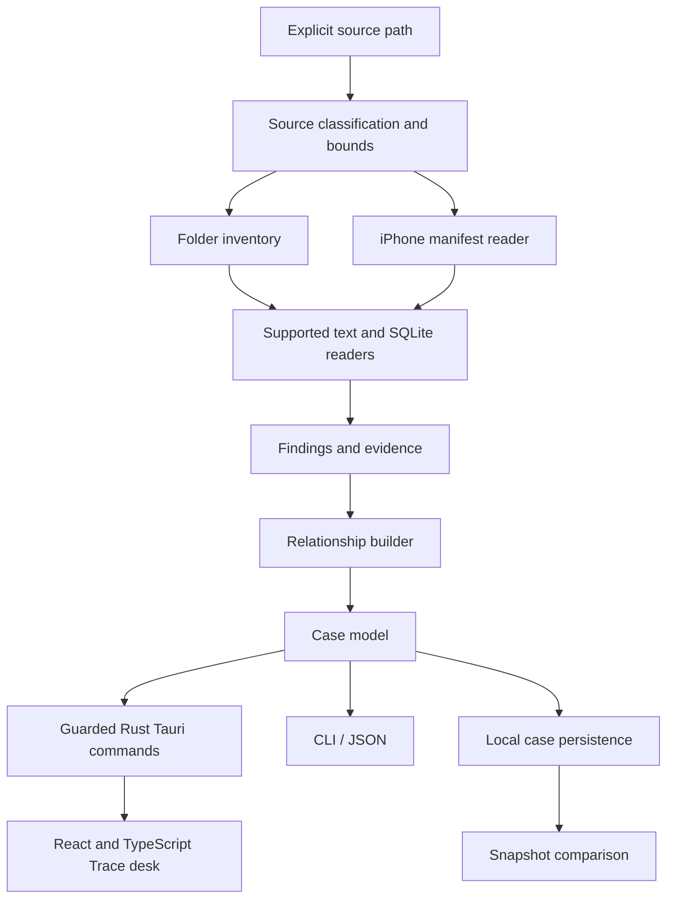

# Architecture

ENGRAM 0.2 combines a shared Rust analysis workspace, a Tauri 2 native shell, and a React/TypeScript renderer. The CLI and desktop call the same core. The renderer does not contain detection rules or an unrestricted filesystem interface.

## Crates

| Crate | Responsibility |
| --- | --- |
| `engram-core` | source reads, bounds, supported parsers, candidate masking, evidence and relationships |
| `engram-desktop` in `apps/desktop/src-tauri` | native window, Rust session, source/case dialogs and guarded IPC commands |
| `engram-cli` | explicit commands, structured output and command-line workflow boundaries |

The frontend lives in `apps/desktop/src`, with Vite configuration and npm lockfile in `apps/desktop`. Its typed bridge exchanges the validated case model with Tauri commands. Production assets are embedded in the native app; the packaged desktop does not need a local Vite server.

The public data model is in `crates/engram-core/src/model.rs`. A case has a schema version, source kind, inspection timestamps, findings, warnings, counters, module states and events. Each finding has an ID, category, source locator, rule, confidence and evidence. Relationships reference existing finding IDs.

## Data flow

1. The user chooses a source or asks for the synthetic demo.
2. The engine classifies the source and applies read bounds.
3. Readers emit evidence and candidate findings; raw secret candidates are masked before persistence.
4. Relationship construction connects artifacts using the implemented rules.
5. The desktop and CLI consume the same case.
6. Saving writes a local JSON case; reopening does not rescan the source.

Desktop scanning runs on a guarded Rust worker. The session rejects overlapping operations, and errors preserve the previous validated active case. A completed case and an error are separate outcomes; an error must not silently become a demonstration or a successful empty result.

## Native command boundary

| Command | Responsibility |
| --- | --- |
| `get_runtime_info` | report version, schema, initial view and explicit smoke-test mode |
| `load_demo` | generate the synthetic source through the real Rust engine |
| `select_source` | choose a folder in a native dialog and run bounded analysis |
| `open_case` | choose a case in a native dialog and validate it before replacing the active case |
| `save_case` | choose a destination and persist the Rust-held active case |
| `compare_case` | choose an earlier case and compare it with the current Rust-held case |
| `finish_smoke_test` | complete an explicit synthetic native/IPC smoke launch; unavailable in normal sessions |

The main window is the authorized command caller. Commands do not accept arbitrary source paths or case objects from React to bypass native selection and validation. The production content security policy allows bundled assets and the Tauri IPC connection, without a general remote content or shell capability.

In a browser-only Vite preview, the UI uses a checked-in case generated by the Rust CLI and marked `source_kind: demo`. Native file operations are unavailable. Browser fixture QA and native IPC verification are deliberately separate evidence paths.

## The Trace map

The Trace map is a navigation surface over the case. Category clusters and finding counts come from case data. A selected cluster opens corresponding findings, and the inspector shows their evidence. Recorded links retain their evidence rule; decorative guides do not create findings or imply additional relationships. The map does not measure leaked records or claim that an AI has verified a secret.

## State and portability

Cases use JSON so a user can examine and move them without a running service. They are sensitive local artifacts. They should be stored separately from source evidence, and should not be committed to the repository.

The CLI and desktop backend build from the Rust workspace. The frontend has its own npm lockfile and runs type checking, Vitest and a production Vite build before native checks. CI verifies Windows, macOS and Linux and separately launches actual Tauri windows under a Linux display. Platform dependencies, lockfile bootstrap and packaging are described in [BUILDING.md](BUILDING.md).

## Deliberate boundaries

- No network dependency in the analysis path.
- No remote model receiving source content.
- No live credential validation or sign-in attempts.
- No source mutation or deleted-data cleanup feature.
- No Keychain decryption or OS protection bypass.
- No permission-to-access inference presented as evidence of an actual read.

Future modules should implement the same evidence, bounds, masking and explicit-state conventions. An unavailable reader should explain its limitation rather than fabricate findings.

## Version history

Version 0.1 used egui/eframe. Its released executables and old screenshots remain historical artifacts. The 0.2 migration changes the desktop shell and renderer while retaining schema-1 cases and the shared Rust analysis pipeline. A screenshot must identify which frontend produced it.

The preview.2 style update adopts the cobalt creature and Trace desk terminology. Its source does not change the analysis or case format. Published preview.1 packages keep their earlier appearance; new identity captures require their own native verification.
