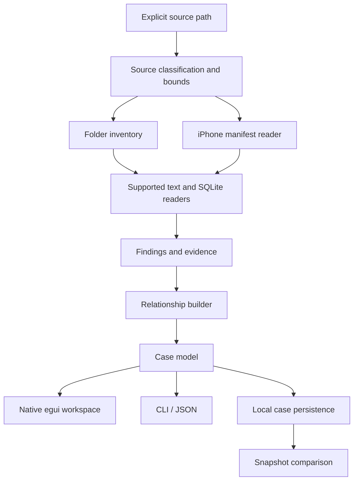

# Architecture

ENGRAM is a Rust workspace with a shared analysis core, a native desktop and a CLI. The frontend does not contain its own detection rules.

## Crates

| Crate | Responsibility |
| --- | --- |
| `engram-core` | source reads, bounds, supported parsers, candidate masking, evidence and relationships |
| `engram-desktop` | native source selection, memory map, inspection views, case opening and comparison |
| `engram-cli` | explicit commands, structured output and command-line workflow boundaries |

The public data model is in `crates/engram-core/src/model.rs`. A case has a schema version, source kind, inspection timestamps, findings, warnings, counters, module states and events. Each finding has an ID, category, source locator, rule, confidence and evidence. Relationships reference existing finding IDs.

## Data flow

1. The user chooses a source or asks for the synthetic demo.
2. The engine classifies the source and applies read bounds.
3. Readers emit evidence and candidate findings; raw secret candidates are masked before persistence.
4. Relationship construction connects artifacts using the implemented rules.
5. The desktop and CLI consume the same case.
6. Saving writes a local JSON case; reopening does not rescan the source.

Desktop scanning runs away from the UI thread. Views should remain responsive while the worker operates. A completed case and an error are separate outcomes; an error must not silently become a demonstration or a successful empty result.

## The brain map

The brain is a navigation surface over the case. Category clusters and finding counts come from case data. A selected cluster opens corresponding findings, and the inspector shows their evidence. The map is not a model of biological neurons, a count of leaked records or a claim that an AI has verified a secret.

## State and portability

Cases use JSON so a user can examine and move them without a running service. They are sensitive local artifacts. They should be stored separately from source evidence, and should not be committed to the repository.

The CLI and desktop both build from the workspace. CI checks the supported desktop targets; platform dependencies and packaging are described in [BUILDING.md](BUILDING.md).

## Deliberate boundaries

- No network dependency in the analysis path.
- No remote model receiving source content.
- No live credential validation or sign-in attempts.
- No source mutation or deleted-data cleanup feature.
- No Keychain decryption or OS protection bypass.
- No permission-to-access inference presented as evidence of an actual read.

Future modules should implement the same evidence, bounds, masking and explicit-state conventions. An unavailable reader should explain its limitation rather than fabricate findings.
